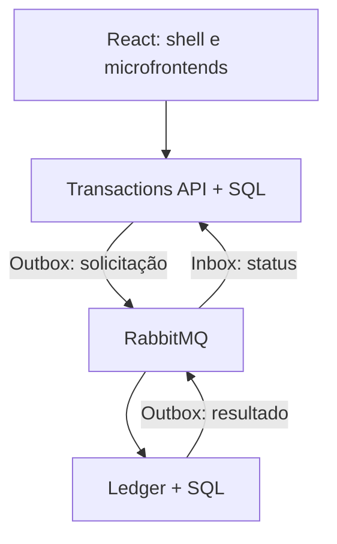

# FinFlow — Plataforma de Transações Financeiras

Projeto independente de portfólio de **Hugo Portugal**. Implementa transferências internas em BRL, com processamento assíncrono, validação de titularidade, histórico e lançamentos de débito/crédito. Não há conexão com bancos, Pix, cartões ou dinheiro real.

A demonstração do portfólio é uma aplicação React que simula as operações no navegador. Este pacote contém também os serviços ASP.NET Core reais, a persistência SQL Server, a integração RabbitMQ, os testes e os arquivos de implantação. Nenhuma experiência em cliente ou capacidade de volume é atribuída a este estudo.

## Entrega e validação

| Componente | Implementação | Validação realizada nesta entrega |
| --- | --- | --- |
| Backend | .NET 8, duas APIs e workers assíncronos | Solução compilada em Release, sem avisos ou erros |
| Regras e JWT | Centavos inteiros, titularidade, validações e autenticação | 16 testes .NET aprovados, incluindo HTTP com TestServer |
| SQL Server | Dois bancos, transações serializáveis, índices, Inbox/Outbox | 2 testes de integração incluídos, não executados aqui: SQL Server/Docker indisponíveis |
| RabbitMQ | Cliente 7, confirmação de publicação, ACK manual, quorum e DLQ | Código compilado; execução com broker real pendente |
| Front-end | React + TypeScript; shell e dois microfrontends ES Modules | Typecheck, 16 testes e três builds aprovados; testes de uso no navegador |
| Auth0 | SDK React e validação JWT RS256 por authority/audience | Integração escrita; tenant real não configurado |
| Docker / AKS | Compose, imagens, manifests, probes, HPA e CD manual | Arquivos revisados; containers e cluster não executados nesta sessão |
| CI/CD | CI de build/teste/integração e CD manual por OIDC | Workflows fornecidos; execução no GitHub/Azure depende de repositório e ambiente |

As verificações SQL e de mensageria continuam sendo requisitos antes de usar o backend em um ambiente compartilhado. Consulte [VALIDATION.md](docs/VALIDATION.md).

## Executar o ambiente completo

Requisitos: Docker com Compose v2, arquitetura x86-64 ou ambiente compatível com SQL Server, portas 8080, 5001, 5002, 1433 e 15672 livres e memória disponível para o SQL Server. Python 3 gera os segredos locais.

```bash
python3 scripts/init-env.py
docker compose up --build -d
python3 scripts/smoke.py
```

Abra **http://localhost:8080**. O front-end deste ambiente usa as APIs reais. O Compose configura exclusivamente desenvolvimento: o endpoint `/dev/token` emite um JWT para `demo-user`, e o Ledger cria duas contas com saldos fictícios de R$ 24.500,00 e R$ 8.150,00. Não exponha este ambiente local à internet. Os segredos são aleatórios, ficam em `.env` e não são versionados.

| Endereço | Uso |
| --- | --- |
| http://localhost:8080 | Interface conectada aos serviços |
| http://localhost:5001/swagger | Transactions API e OpenAPI |
| http://localhost:5002/swagger | Ledger API e OpenAPI |
| http://localhost:15672 | RabbitMQ Management; usuário `finflow`, senha no `.env` local |
| `/health/live` e `/health/ready` em cada API | Processo ativo e disponibilidade de banco/broker |

No Swagger, faça `POST /dev/token`, copie `accessToken` e use **Authorize**. [requests.http](docs/requests.http) traz exemplos de chamadas. Os dados sobrevivem à recriação dos containers por volumes locais. `docker compose down` para os serviços preservando os volumes; remova volumes apenas quando quiser descartar os dados.

## Testar os comportamentos

1. Transfira R$ 1.250,00 da conta operacional para a reserva. O total permanece R$ 32.650,00.
2. Reenvie a última solicitação. A mesma chave retorna o mesmo ID e não cria um novo débito.
3. Use uma quantia acima do saldo. A transferência passa pela fila e termina recusada, sem alteração dos saldos.
4. Na demonstração do navegador, pause o processamento, envie duas operações e processe a fila. O saldo é validado em cada operação, na ordem de envio.
5. Exporte o histórico em CSV e abra os detalhes de uma operação para acompanhar seu resultado.

No ambiente completo, a fila é controlada pelo worker. A pausa e o botão de processamento manual existem apenas na demonstração. A interface da API consulta o resultado a cada três segundos.

## Arquitetura



**Transactions** recebe a solicitação, valida os campos, autentica o usuário e grava a operação e a Outbox no mesmo commit. Retorna HTTP 202. O publisher confirma a entrega ao broker antes de marcar a mensagem como publicada.

**Ledger** verifica novamente a titularidade da conta de origem, a moeda, o saldo e o destino. Saldo, débito, crédito, registro de processamento e evento de resultado pertencem à mesma transação serializável. Locks são adquiridos em ordem determinística; deadlocks e timeouts de lock têm repetição limitada.

O resultado volta pela fila. A Inbox do serviço de transações deduplica a entrega e atualiza o estado `Queued → Completed | Rejected`. A política é **entrega ao menos uma vez com processamento idempotente**, não uma promessa de transporte “exactly once”. Consulte [ARCHITECTURE.md](docs/ARCHITECTURE.md).

## Código e testes sem Docker

Requisitos: SDK .NET 8.0.428, Node.js 22 ou superior compatível e npm.

```bash
dotnet build FinFlow.sln -c Release -m:1
dotnet test FinFlow.sln -c Release -m:1
cd web
npm ci
npm run typecheck
npm test
npm run build
npm run dev
```

O último comando compila e serve a demonstração em http://localhost:5173. Os testes de SQL são ignorados explicitamente quando `FINFLOW_TEST_SQL` não está configurada. Com o Compose iniciado e o SDK instalado, execute `python3 scripts/integration.py` na pasta FinFlow; o script usa apenas os bancos descartáveis do ambiente local.

O código está organizado em `src/FinFlow.Core`, `src/FinFlow.Infrastructure`, `src/FinFlow.Transactions.Api`, `src/FinFlow.Ledger.Api`, `tests`, `web/apps/{shell,transfers,analytics}` e `web/packages/contracts`. Cada microfrontend tem build próprio; `mount/unmount` recebe um contrato tipado e se conecta ao cliente de dados compartilhado. A montagem padrão usa mesma origem e bundles React separados. Distribuição em CDNs e versionamento independente podem ser configurados sem mudar a regra de negócio.

## Auth0 e Azure AKS

Para uma implantação autenticada, configure um aplicativo SPA Auth0, uma API com audience e RS256 e os callbacks/origens permitidos. Preencha as variáveis `VITE_AUTH0_*` no build da interface; nas APIs, use `Auth0__Authority=https://SEU_DOMINIO/` e `Auth0__Audience`. A interface mantém o token em memória e obtém access tokens pelo SDK. Nenhum client secret pertence ao navegador. O modo `Development` é recusado fora do ambiente Development.

[DEPLOYMENT.md](docs/DEPLOYMENT.md) contém os pré-requisitos e o procedimento de AKS: SQL e broker com TLS, segredos externos, credenciais separadas para migração, imagens no ACR, ingress com certificado e rollout com probes. Os manifests preparam a aplicação; não provisionam serviços Azure nem movimentam recursos nesta entrega.

O código-fonte está publicado em [hugoportugal921/meu-portfolio — FinFlow](https://github.com/hugoportugal921/meu-portfolio/tree/main/projects/FinFlow). Os workflows de exemplo ficam na pasta `.github/workflows` deste projeto; para usá-los em um repositório dedicado, coloque a pasta FinFlow na raiz desse repositório.

## Limites e próximos passos técnicos

Esta versão trabalha com transferências internas em BRL, duas casas decimais, histórico recente de até 100 registros por consulta e contas previamente provisionadas. Não implementa câmbio, crédito externo, estorno, reconciliação bancária ou autorização regulatória. O volume máximo por requisição é R$ 1 bilhão como limite técnico de demonstração, sem correspondência com limite bancário.

Antes de ampliar o uso, execute os testes SQL/RabbitMQ e de recuperação, meça carga/latência, configure retenção e arquivamento de Inbox/Outbox, acrescente paginação por cursor e monitore atraso da fila e mensagens mortas. O publisher atual usa confirmação por mensagem; não foi realizado benchmark de alto volume. O baseline de banco é versionado; evoluções devem ser novas migrações, sem editar um baseline já aplicado.
